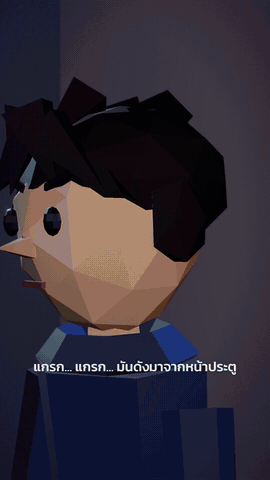
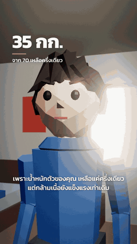
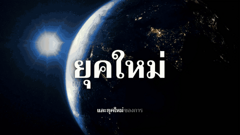
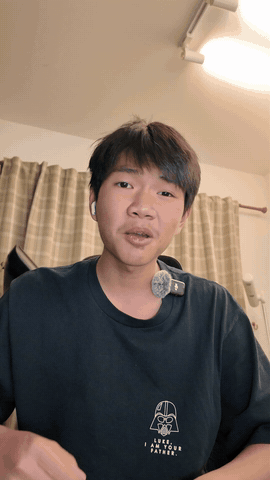

# ชุดทำวิดีโอด้วย Claude Code (สกิล + ติดตั้งคำสั่งเดียว)

ติดตั้งครั้งเดียว แล้วสั่ง Claude Code ทำคลิปได้เลย ผลลัพธ์เป็นไฟล์ **MP4** ทุกครั้ง

## ติดตั้ง (Windows 10/11)

เปิด **PowerShell** แล้ววางบรรทัดนี้:

```powershell
irm https://raw.githubusercontent.com/Peam67/claude-code-video-kit/main/install.ps1 | iex
```

สคริปต์ติดตั้งให้ครบโดยไม่ถามอะไร ถ้าเครื่องมีอยู่แล้วจะข้ามไป
ติดตั้งเสร็จแล้ว **ปิดแล้วเปิด Claude Code ใหม่**

## เริ่มใช้

เปิดแชตใหม่ใน Claude Code แล้ววางข้อความนี้:

```
ในเครื่องฉันติดตั้งชุดทำวิดีโอไว้แล้ว มีสกิล lowpoly-3d, documentary-clip, talking-head-cut และ HyperFrames
เดี๋ยวฉันจะสั่งทำคลิป ผลงานต้องออกมาเป็นไฟล์ MP4 เท่านั้น ห้ามทำเป็นหน้าเว็บ ห้ามทำเป็น Artifact หรือลิงก์
ถ้าฉันให้ API key ของบริการไหนไป ทุกครั้งที่ทำคลิปเสร็จ ให้บอกด้วยว่าเครดิตเหลือเท่าไหร่ คลิปนี้ใช้ไปเท่าไหร่ และน่าจะทำได้อีกประมาณกี่คลิป
สิ่งที่ฉันอยากให้นายทำก็คือ "ข้อความ"
```

เปลี่ยน `"ข้อความ"` เป็นคลิปที่อยากได้ ส่งรูปหรือคลิปอ้างอิงไปด้วยก็ได้

ถ้าต้องใช้ API key (เช่น เสียงพากย์ หรือภาพสต็อก) ให้บอก Claude ตอนสั่งงานว่าคีย์อยู่ตรงไหน เช่น
`API key ของ ElevenLabs อยู่ในไฟล์ C:\...\key.txt ให้เอามาจากตรงนั้น`

## เอา API key จากไหน

ไม่มีคีย์ก็ทำคลิปได้ คีย์จำเป็นเฉพาะงานที่ต้องใช้เสียงพากย์ AI หรือภาพสต็อก
ได้คีย์มาแล้ว เก็บไว้ที่ไหนก็ได้ (เช่น ไฟล์ข้อความในเครื่อง) แล้วตอนสั่งงานค่อยบอก Claude ว่าเก็บไว้ตรงไหน

**ElevenLabs (เสียงพากย์ ใช้แพ็กฟรีได้แต่มีเงื่อนไข)**
1. สมัครที่ [elevenlabs.io](https://elevenlabs.io)
2. ในแดชบอร์ด หาเมนู **API Keys** แล้วกดสร้างคีย์ คีย์จะขึ้นต้นด้วย `sk_`
   ถ้ามีให้เลือกสิทธิ์ ให้เปิดสิทธิ์อ่านข้อมูลผู้ใช้ (User: Read) ด้วย Claude ถึงจะเช็กเครดิตที่เหลือได้
3. เงื่อนไขของแพ็กฟรี:
   - ใช้ได้เฉพาะ **เสียงสำเร็จรูป (premade)** เท่านั้น เสียงจาก Voice Library เรียกผ่าน API ไม่ได้
   - ต้องใช้โมเดล `eleven_v3` เพราะโมเดลเก่าพูดไทยเป็นสำเนียงฝรั่ง
   - ได้เครดิตฟรีราว 10,000 ตัวอักษร (ดูยอดจริงในหน้าบัญชี) พอสำหรับคลิปสั้นไม่กี่คลิป

**Pixabay (ภาพและวิดีโอสต็อก ฟรี)**
1. สมัครที่ [pixabay.com](https://pixabay.com) แล้วล็อกอิน
2. เปิด [pixabay.com/api/docs](https://pixabay.com/api/docs/) คีย์ของคุณจะอยู่ในหน้านั้น เป็นตัวอักษรและตัวเลขยาวๆ

> ⚠️ **คำเตือน**
> - **อย่าสมัคร ElevenLabs ผ่าน VPN หรือพร็อกซี และอย่าสมัครหลายบัญชี** ระบบจะบล็อกบัญชีถาวร (`detected_unusual_activity`) และขอคืนไม่ได้
> - **อย่าวางคีย์ลงในแชต** ให้บอกแค่ว่าเก็บไว้ที่ไหน
> - อย่าเอาไฟล์ที่มีคีย์ไปแชร์ อัปขึ้น GitHub หรือเปิดให้เห็นตอนอัดคลิป ถ้าคีย์หลุดไปแล้ว ให้ลบคีย์นั้นแล้วสร้างใหม่ทันที

## มีอะไรบ้าง

| สกิล | ใช้ทำ |
| --- | --- |
| `lowpoly-3d` | คลิปตัวละครและฉาก 3D แบบ low-poly เช่น ละครสั้น หรือคลิป what if |
| `documentary-clip` | คลิปตัดต่อเร็ว ภาพเปลี่ยนตามคำพูด มีซับทีละคำ คำใหญ่กระแทกจอ และการ์ดปิดท้าย |
| `talking-head-cut` | ตัดคลิปพูดหน้ากล้อง: ตัดคำผิด เลือกเทคที่ดีที่สุด และเก็บช่องไฟให้กระชับ |

### ตัวอย่างคลิปที่ทำด้วยชุดนี้

ภาพตัวอย่างด้านล่างตัดมาสั้นๆ และไม่มีเสียง

**`lowpoly-3d`**

| ละครซอมบี้ 30 วินาที | What if: แรงโน้มถ่วงหายไปครึ่งหนึ่ง (2 นาที) |
| --- | --- |
|  |  |

**`documentary-clip`** คลิปสไตล์สารคดี 53 วินาที ภาพเปลี่ยนตามคำพูด มีคำใหญ่กระแทกจอ



**`talking-head-cut`** คลิปดิบ 113 วินาทีที่พูดซ้ำหลายเทค เครื่องมือตัดเหลือ 26.7 วินาที (ตัดเองอัตโนมัติ ไม่ได้แต่งเพิ่ม)



### รายงานเครดิต

ถ้าให้ API key ไป ทุกครั้งที่ทำคลิปเสร็จ Claude จะบอกท้ายข้อความว่า
- เครดิตเหลือเท่าไหร่
- คลิปนี้ใช้ไปเท่าไหร่
- น่าจะทำได้อีกประมาณกี่คลิป
- เครดิตจะรีเซ็ตวันไหน

ตัวอย่าง: `เครดิต ElevenLabs: เหลือ 8,120 / 10,000 ตัวอักษร · คลิปนี้ใช้ 864 · ทำได้อีกราว 9 คลิปแบบนี้ · รีเซ็ต 15 พ.ย.`

บริการที่ไม่มีระบบเครดิต (เช่น Pixabay ใช้ฟรี) จะบอกว่าไม่มีเครดิตให้นับ

สกิลบอกแค่ว่าคลิปที่ดีควรเป็นแบบไหน และใช้เครื่องมืออะไร
เรื่อง ความยาว เสียง เพลง และสไตล์ ไม่ได้ล็อกไว้ บอกเองตอนสั่ง

## สคริปต์ติดตั้งลงอะไรให้

- Node.js, Python 3, FFmpeg (ผ่าน winget)
- แพ็กเกจ Python: numpy, soundfile, pythainlp, yt-dlp
- HyperFrames CLI และสกิลของ HyperFrames
- whisper.cpp (แปลงเสียงเป็นข้อความ)
- ฟอนต์ไทย Trirong และ Kanit
- สกิล 3 ตัวในรีโปนี้ ลงที่ `%USERPROFILE%\.claude\skills`

สคริปต์ไม่ถาม ไม่อ่าน และไม่เก็บ API key ใดๆ

## ข้อควรรู้

- ทดสอบบน Windows 11
- ใช้พื้นที่ราว 3.4 GB
- ตอนเรนเดอร์ต้องมีที่ว่างในไดรฟ์ TEMP อย่างน้อย 5 GB
- ถ้าใช้เพลงหรือฉากหนังที่มีลิขสิทธิ์ แพลตฟอร์มอาจปิดเสียงหรือลบคลิปได้

---

# รายละเอียด

## จะใช้พื้นที่กี่ GB

ตัวเลขวัดจริงบนเครื่องที่ทำชุดนี้ (1 GB = 1024³ ไบต์)

| ส่วน | ใช้ดิสก์ (GB) |
|---|---|
| Node.js | 0.11 |
| Python 3 + แพ็กเกจ | 0.33 |
| FFmpeg | 0.65 |
| HyperFrames CLI | 0.09 |
| Chrome headless shell (ตัวเรนเดอร์ของ HyperFrames โหลดตอนเรนเดอร์ครั้งแรก) | 0.26 |
| whisper.cpp | 0.02 |
| โมเดล Whisper "medium" (ซับภาษาไทย โหลดตอนถอดเสียงครั้งแรก) | 1.43 |
| ฟอนต์ไทย | < 0.01 |
| สกิล lowpoly-3d พร้อมแพ็กเกจ | 0.06 |
| **รวม** | **≈ 3.0** |

ตอนติดตั้งควรมีที่ว่างอย่างน้อย 5 GB
งานหนึ่งคลิป (ภาพหรือคลิปที่โหลดมา + ไฟล์ทำงาน) ใช้อีกราว 0.3–0.7 GB

## ระหว่างเรนเดอร์ต้องเหลือที่ว่างเท่าไหร่

การเรนเดอร์ 1080p 30 fps เขียนเฟรมชั่วคราวราว **0.02 GB ต่อวินาทีของคลิป** (วัดจริง 1.03 GB สำหรับคลิป 50 วินาที)
ไฟล์ชั่วคราวลงไดรฟ์ที่เก็บ `TEMP` ซึ่งปกติคือ C:

| ความยาวคลิป | เหลือขั้นต่ำ | แนะนำให้เหลือ |
|---|---|---|
| 30 วินาที | 1.6 GB | 5 GB |
| 60 วินาที | 2.2 GB | 5 GB |
| 120 วินาที | 3.5 GB | 7 GB |
| 180 วินาที | 4.7 GB | 9.5 GB |

ถ้า C: ไม่พอ บอก Claude ให้ย้ายไฟล์ชั่วคราวไปไดรฟ์อื่นก่อนเรนเดอร์
**RAM:** เครื่องที่ทำชุดนี้มี 32 GB ยังไม่ได้ทดสอบกับเครื่อง RAM น้อย ถ้า whisper ล้มเหลวเงียบๆ (ถอดเสียงออกมาเป็นค่าว่าง) ให้ปิดโปรแกรมหนักๆ เช่น โปรแกรมตัดต่อ หรือเบราว์เซอร์ที่เปิดแท็บเยอะ แล้วลองใหม่

## สกิลแต่ละตัวทำอะไร

**`lowpoly-3d`**
- สไตล์ภาพ 3D แบบเหลี่ยม (low-poly):
  - หัวกลมเหลี่ยม ตาจุด จมูกเล็ก
  - แสงแดดอุ่น เงานุ่ม ฉากหลังเบลอ แสงฟุ้ง และเกรนฟิล์ม
- มี kit พร้อมใช้: ตัวละคร ท่าทาง ต้นไม้ หญ้า แสง 5 แบบ กล้องตัดช็อต และซับไทย
- ทุกคลิปก๊อป kit ไปไว้โฟลเดอร์ใหม่ ดูภาพนิ่งก่อน แล้วค่อยเรนเดอร์เป็น MP4

**`documentary-clip`**
- เป็นคู่มือที่ Claude อ่านก่อนลงมือ ลำดับงานตั้งแต่ตัดช่วงเงียบ เขียนบท ทำเสียง วางแผนภาพ หาภาพ ประกอบ ผสมเพลง ตรวจ จนถึงเรนเดอร์
- มีตารางกับดักที่เจอจริง เช่น:
  - ท่า invert เรนเดอร์ออกมาเป็นวงรีขาว
  - ภาพ HDR ทำให้สีเพี้ยนทั้งคลิป
  - ดิสก์เต็มตอนเรนเดอร์
  - Pixabay ตอบ 403
- มี `references/motion-library.md` ที่สรุปท่า motion เป็นตัวเลขเฟรม (ซับ คำใหญ่ ตัวนับ ท่าเปลี่ยนภาพ คอลลาจ สโตรบ CTA) ได้จากการวัดคลิปตัวอย่างทีละเฟรม
- เครื่องมือในสกิล:
  - `tighten_silence.py` ตัดช่วงเงียบ
  - `eleven_tts_lines.py` สร้างเสียง ElevenLabs ทีละบรรทัด หลายรอบ แล้วเลือกรอบที่ถอดเสียงกลับได้ถูกที่สุด

**`talking-head-cut`**
- วิธีตัดคำผิดและช่องไฟที่ได้จากการวัดคลิปที่คนตัดเองจริง (คลิปดิบ 113 วินาที → 25.3 วินาที, 15 จุดตัด)
- เลือกเทคที่สะอาดที่สุด ซึ่งไม่จำเป็นต้องเป็นเทคสุดท้าย
- ตัดพูดผิดกลางประโยค
- เว้นช่องไฟราว 0.18 วินาทีระหว่างประโยคที่ต่อกัน และราว 0.42 วินาทีก่อนขึ้นประเด็นใหม่
- ไม่ตัดจังหวะเว้นของรายการ เช่น "ซับ / ภาพ / เอฟเฟกต์"
- ผลทดสอบกับคลิปจริง:
  - เลือกเทคตรงกับที่คนเลือกทั้ง 15 ประโยค
  - จุดตัดห่างจากของคนตัดเฉลี่ย (มัธยฐาน) 69 มิลลิวินาที (ราว 2 เฟรม)
  - ได้คลิปยาว 26.7 วินาที (คนตัดได้ 25.3)

## ปัญหาที่เจอบ่อย

| อาการ | แก้ |
|---|---|
| `File name too long` หรือเปิดเครื่องมือไม่ได้ | โฟลเดอร์ทำงาน path ยาวเกินไป ให้ย้ายไปที่สั้นๆ เช่น `D:\clips\x` |
| เรนเดอร์ล้มเหลวเพราะพื้นที่ดิสก์ | ย้ายไฟล์ชั่วคราว (`TEMP`, `TMP`) ไปไดรฟ์ที่ว่างก่อนเรนเดอร์ |
| ElevenLabs `detected_unusual_activity` | บัญชีถูกบล็อก (มักเพราะ VPN หรือสมัครหลายบัญชี) แก้ไม่ได้ ต้องใช้บัญชีใหม่ที่ไม่ผ่าน VPN หรืออัปเกรดแพ็ก |
| ElevenLabs `paid_plan_required` หรือ `voice_not_found` | ใช้เสียงจาก Library บนแพ็กฟรี ให้เปลี่ยนเป็นเสียง premade |
| Pixabay ตอบ 403 | ไม่ได้ส่ง `User-Agent` (Claude Code ใส่ให้เอง) |
| สกิลใหม่ไม่ทำงาน | ปิดแล้วเปิด Claude Code ใหม่หลังติดตั้ง |
| Claude จะทำเป็นหน้าเว็บ | ย้ำในข้อความสั่งว่าต้องเป็นไฟล์ MP4 |
| คำอังกฤษหรือศัพท์เทคนิคออกเสียงเพี้ยน | สร้างเสียงหลายรอบแล้วเลือกรอบที่ถอดเสียงกลับได้ถูกที่สุด หรือสะกดเป็นไทยตามเสียงที่ต้องการ |

## ข้อจำกัดที่ควรรู้ (พูดตรงๆ)

- **Claude Code ฟังเสียงไม่ได้** ตรวจได้แค่ความดัง จังหวะ และถอดเสียงกลับด้วย whisper ว่าตรงบทไหม ส่วนน้ำเสียงต้องฟังเอง
- **ใช้เวลาและ token ไม่น้อย** โดยเฉพาะรอบแก้งาน ถ้าติดลิมิตง่าย ให้ข้ามการให้ตรวจซ้ำหลายรอบ
- **เรนเดอร์ช้า** คลิป low-poly ใช้เวลาราว 15–25 นาทีต่อวิดีโอ 1 นาที
- **ทดสอบบนเครื่องเดียว** ยังไม่เคยรันสคริปต์ติดตั้งบนเครื่องที่ว่างเปล่า ถ้าติดขัด เปิด Issue ได้
- **ลิขสิทธิ์:** ถ้าใช้ฉากหนังหรือเพลงที่มีลิขสิทธิ์ แล้วโพสต์ลง IG/TikTok/YouTube ระบบอาจปิดเสียงหรือเอาคลิปลง รีโปนี้มีแค่ภาพตัวอย่างสั้นๆ แบบไม่มีเสียง ไม่ได้แจกเพลงหรือฉากหนังใดๆ
- ไม่มีความเกี่ยวข้องกับ Anthropic, HeyGen, ElevenLabs หรือ Pixabay เป็นชุดที่รวมไว้ใช้เอง

## ขอบคุณเครื่องมือเหล่านี้

[HyperFrames](https://hyperframes.heygen.com) · [three.js](https://threejs.org) · [whisper.cpp](https://github.com/ggml-org/whisper.cpp) · [FFmpeg](https://ffmpeg.org) · [yt-dlp](https://github.com/yt-dlp/yt-dlp) · [PyThaiNLP](https://github.com/PyThaiNLP/pythainlp) · [Pixabay](https://pixabay.com) · [ElevenLabs](https://elevenlabs.io) · ฟอนต์ Trirong/Kanit (SIL OFL)

## License

MIT (ดูไฟล์ `LICENSE`) ครอบคลุมสคริปต์และเอกสารในรีโปนี้ ส่วนเครื่องมือและโมเดลที่สคริปต์ดาวน์โหลดมา เป็นไปตามไลเซนส์ของแต่ละตัว
